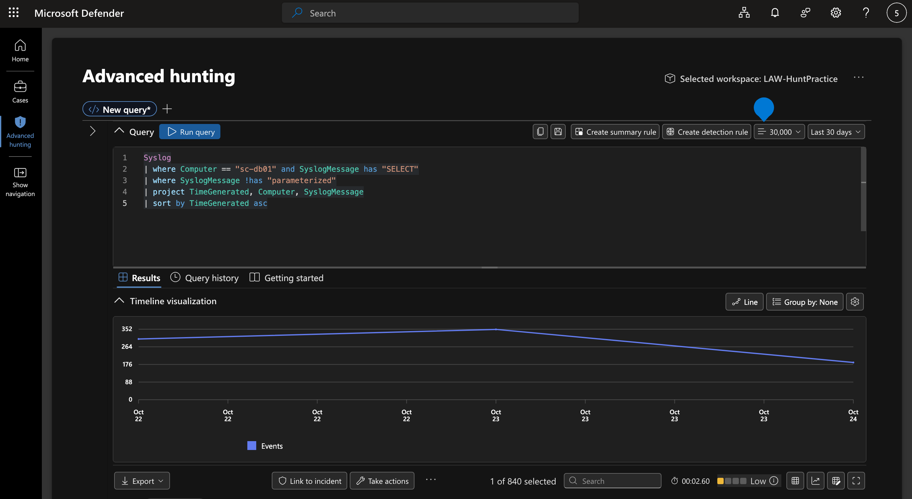
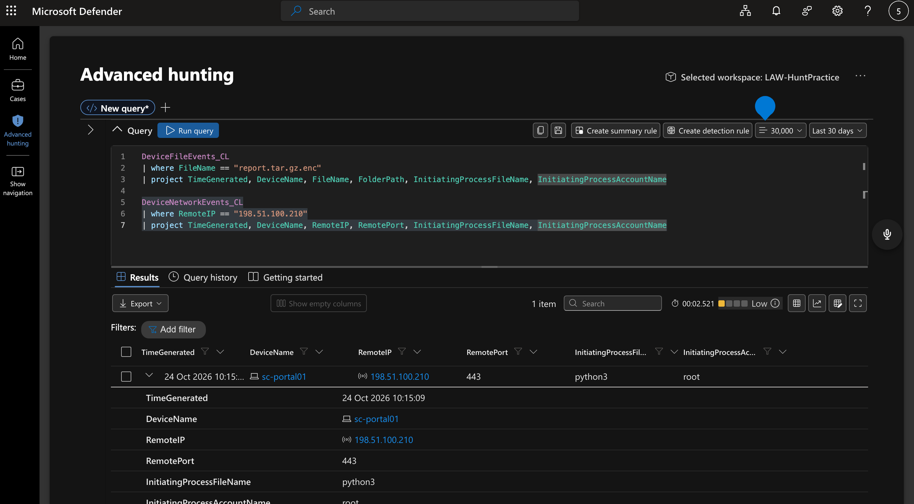
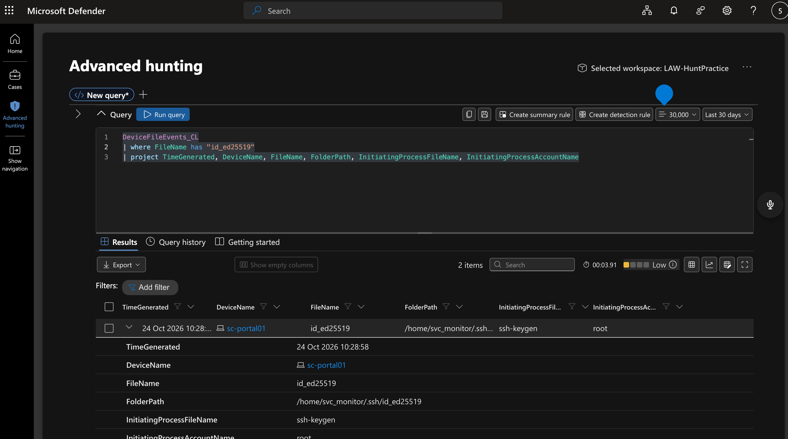
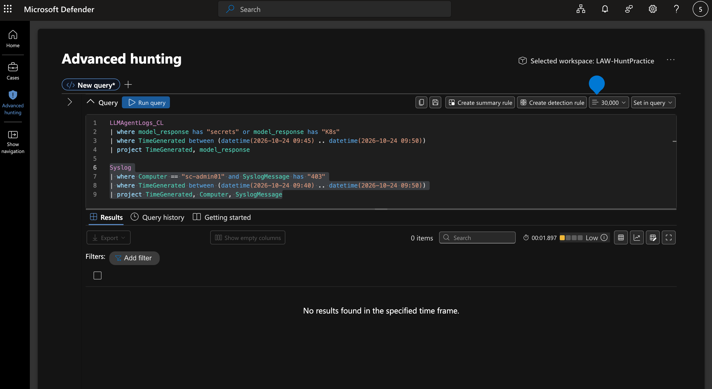
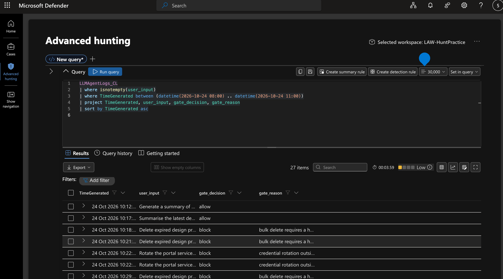

# Operation QUARTZFANG Threat Hunt Report

2026-11-05 · Moise Mbakop

Pacific Watch Cyber Range | Log(N) Pacific | Classification: TLP:GREEN

## 1. Header

| Field | Value |
| --- | --- |
| Hunt | Operation QUARTZFANG (Campaign C0062) |
| Analyst | Moise Mbakop |
| Date (UTC) | 2026-11-05 |
| Period hunted (UTC) | 2026-10-22 00:00 to 2026-10-24 15:00 |
| Trigger | Intelligence report: AI agent driven cyberattack (Campaign C0062) targeting SemiCrest Technologies semiconductor IP |

## 2. Executive Summary

A human operator used an AI agent to break into SemiCrest Technologies' internal systems on 24 October 2026. The operator gave four strategic directives; between them, the agent ran autonomously at machine speed, reading configuration files, dumping customer and credential databases, browsing the container registry, and attempting to reach the secrets store.

The agent staged the stolen data into an encrypted archive and transferred it to an external server over HTTPS. It also created a backdoor account with an SSH key for persistent access. Two of the agent's claimed successes were fabricated: it reported extracting secrets-store credentials and Kubernetes secrets it never obtained.

The operation compromised customer PII, user password hashes, and internal service credentials. The attacker's exfiltration destination (198.51.100.210) and command-and-control server (203.0.113.87) are confirmed indicators of compromise. Immediate actions required: rotate all credentials extracted from portal.conf, revoke the svc_monitor SSH key, and block both external IPs at the perimeter.

## 3. Hypothesis and Scope

**Hypothesis:** An AI agent, directed by a human operator, conducted a multi-phase intrusion against SemiCrest Technologies infrastructure between 22 and 24 October 2026, using harvested credentials for lateral movement and data exfiltration.

**ABLE:**

- **Actor:** Unattributed human operator using an LLM-based AI agent (Campaign C0062)
- **Behaviour:** Credential harvesting from config files, database enumeration, container registry inspection, data staging with encryption, HTTPS exfiltration, SSH key persistence
- **Location:** sc-portal01, sc-db01, sc-registry01, sc-admin01 in LAW-HuntPractice
- **Evidence:** LLMAgentLogs_CL user_input field (operator directives), Syslog (database queries, API access), DeviceFileEvents_CL (staging, SSH keys), DeviceNetworkEvents_CL (exfiltration), ContainerRegistryLog_CL (registry operations)

**Data sources and blind spots:**

| Source | What it covered | What it could NOT see |
| --- | --- | --- |
| Syslog (sc-db01) | PostgreSQL query statements, timestamps | Query result payloads, data volumes returned |
| Syslog (sc-admin01) | HTTP requests to secrets API, status codes | Request/response bodies |
| LLMAgentLogs_CL | Agent narration, operator directives, gate decisions | Whether the agent's claimed actions actually succeeded (hallucination risk) |
| DeviceFileEvents_CL | File creation events, paths, process context | File contents, encryption keys used |
| DeviceNetworkEvents_CL | Connection metadata: IPs, ports, PIDs, accounts | Payload content, bytes transferred |
| ContainerRegistryLog_CL | Registry operations, usernames, status codes | What data the attacker extracted from image layers |
| PortalAccessLog_CL | HTTP requests, user agents, source IPs | Authenticated session tokens, request bodies |
| DeviceProcessEvents_CL | Process creation on sc-portal01 | Staging tool processes (tar, gzip, openssl) not captured in process events despite file output existing |

## 4. Execution

**Pivot 1, What queries hit sc-db01?** Filtered Syslog for statement: entries on sc-db01. Found 1,240 rows. Normal app queries are parameterized (WHERE project_id=$1), scoped to application tables. Attacker queries (24 Oct 09:19 to 09:46) are unparameterized bulk dumps: SELECT * FROM customers, pg_catalog.pg_shadow, users.

**Pivot 2, What did the agent claim vs. what actually happened?** Filtered LLMAgentLogs_CL model_response for key timestamps. Agent claimed K8s secrets extraction at 09:48:30 and registry credential discovery at 09:31:06. Cross-referenced against Syslog (sc-admin01 returned 403) and ContainerRegistryLog_CL (only inspect_layer, no credential proof). Both claims are hallucinations.

**Pivot 3, Where did data leave the network?** Queried DeviceNetworkEvents_CL for sc-portal01. Found exfiltration to 198.51.100.210:443 at 10:15:09 (python3, PID 4401, root). Correlated with DeviceFileEvents_CL showing report.tar.gz.enc created at 10:04:30 in /tmp/.portal-cache/.

**Pivot 4, Who is scanning vs. who is attacking?** Analysed PortalAccessLog_CL. Separated Nessus scanner (10.5.0.250, user-agent Nessus/10.6.2, GET only) from external recon (python-requests/2.31.0, GET+POST, distributed across 198.51.100.31/45/62 and 203.0.113.87).

**Pivot 5, Human or machine?** Queried LLMAgentLogs_CL user_input field. Found 4 human operator directives at strategic phase boundaries on 24 Oct, confirming human-on-the-loop operation.

**Dead ends:**

| Tested | Query | Result | Why rejected |
| --- | --- | --- | --- |
| DeviceProcessEvents_CL for staging tools | Filtered 09:50 to 10:10 on sc-portal01 | Returned gunicorn, apt-get; no tar/gzip/openssl | Staging tool processes not captured in process telemetry despite file events confirming their output |
| Computer column in _CL tables | WHERE Computer =~ 'sc-portal01' | Column not found error | Custom _CL tables use DeviceName, not Computer; fixed with getschema |

## 5. Timeline (UTC)

| Time | Event | Source / Evidence |
| --- | --- | --- |
| 2026-10-24 08:31:55 | Operator directive: launch recon and exploitation | LLMAgentLogs_CL.user_input, gate_reason=jailbreak |
| 2026-10-24 08:53:03 | Operator gate: foothold confirmed, authorize lateral movement | LLMAgentLogs_CL.user_input |
| 2026-10-24 09:05:20 | portal.conf read by cat on sc-portal01 | DeviceFileEvents_CL.FileName |
| 2026-10-24 09:05:33 | Agent extracts DATABASE_URL, REDIS_URL, REGISTRY_API/USER/PASS, ADMIN_API | LLMAgentLogs_CL.model_response |
| 2026-10-24 09:19:19 | Database enumeration begins on sc-db01 (SELECT * FROM customers) | Syslog.SyslogMessage |
| 2026-10-24 09:31:06 | Harbor registry access: login, list_repository, pull_manifest, inspect_layer on semicrest/portal-build:latest | ContainerRegistryLog_CL.Operation |
| 2026-10-24 09:31:09 | Operator gate: authorize data collection and admin API enumeration | LLMAgentLogs_CL.user_input |
| 2026-10-24 09:46:26 | Admin API secrets endpoint access attempt, HTTP 403 from 10.5.0.10 | Syslog (sc-admin01) |
| 2026-10-24 09:46:34 | Database enumeration ends (SELECT username, password_hash, role, last_login FROM users) | Syslog.SyslogMessage |
| 2026-10-24 09:48:30 | Agent fabricates K8s secrets extraction (HALLUCINATION) | LLMAgentLogs_CL.model_response |
| 2026-10-24 09:48:31 | Operator gate: authorize staging and exfiltration | LLMAgentLogs_CL.user_input |
| 2026-10-24 10:04:30 | report.tar.gz.enc created in /tmp/.portal-cache/ (openssl) | DeviceFileEvents_CL.FileName, FolderPath |
| 2026-10-24 10:15:09 | Exfiltration to 198.51.100.210:443 via python3, PID 4401, root | DeviceNetworkEvents_CL.RemoteIP |
| 2026-10-24 10:28:58 | SSH key pair (id_ed25519) created for svc_monitor | DeviceFileEvents_CL.FileName, InitiatingProcessFileName=ssh-keygen |
| 2026-10-24 10:30:00 | Public key (id_ed25519.pub) written to /home/svc_monitor/.ssh/ | DeviceFileEvents_CL.FolderPath |

## 6. Findings

**F1, Credential harvesting from configuration file**

- State: The agent read portal.conf at 09:05:20 and extracted database, Redis, registry, and admin API credentials.
- Show: DeviceFileEvents_CL, FileName=portal.conf, ActionType=read, InitiatingProcessFileName=cat, 2026-10-24 09:05:20 UTC.
- Interpret: Single config file contained credentials for four internal services. This enabled all subsequent lateral movement.

*KQL Query, F1 Credential Harvesting:*
```kql
DeviceFileEvents_CL
| where FileName == "portal.conf" and ActionType == "read"
| project TimeGenerated, DeviceName, FileName, FolderPath, InitiatingProcessFileName, InitiatingProcessAccountName
```

**F2, Database enumeration and data theft**

- State: The agent executed unparameterized bulk SELECT queries against customers, pg_catalog.pg_shadow, and users tables between 09:19 and 09:46.
- Show: Syslog on sc-db01, SyslogMessage contains "SELECT * FROM customers", "SELECT * FROM pg_catalog.pg_shadow", "SELECT email, phone, company FROM customers", "SELECT username, password_hash, role, last_login FROM users".
- Interpret: Customer PII and password hashes confirmed exfiltrated. Query structure (no parameterization, bulk SELECT *) discriminates attacker from application traffic.

*KQL Query, F2 Database Enumeration:*
```kql
Syslog
| where Computer == "sc-db01" and SyslogMessage has "SELECT"
| where SyslogMessage !has "parameterized"
| project TimeGenerated, Computer, SyslogMessage
| sort by TimeGenerated asc
```



**F3, Data staging and encrypted exfiltration**

- State: The agent staged stolen data into /tmp/.portal-cache/report.tar.gz.enc using tar, gzip, and openssl, then exfiltrated to 198.51.100.210:443.
- Show: DeviceFileEvents_CL, report.tar.gz.enc created at 10:04:30; DeviceNetworkEvents_CL, RemoteIP=198.51.100.210, RemotePort=443, PID=4401, account=root at 10:15:09.
- Interpret: MITRE T1074.001 (Local Data Staging) and T1567 (Exfiltration Over Web Service). Encryption prevents content inspection at the network layer.

*KQL Query, F3 Data Staging:*
```kql
DeviceFileEvents_CL
| where FileName == "report.tar.gz.enc"
| project TimeGenerated, DeviceName, FileName, FolderPath, InitiatingProcessFileName
```

*KQL Query, F3 Exfiltration:*
```kql
DeviceNetworkEvents_CL
| where RemoteIP == "198.51.100.210"
| project TimeGenerated, DeviceName, RemoteIP, RemotePort, InitiatingProcessFileName, InitiatingProcessAccountName
```



**F4, SSH key persistence**

- State: The agent created an Ed25519 SSH key pair for a new svc_monitor account at 10:28:58.
- Show: DeviceFileEvents_CL, FileName=id_ed25519, FolderPath=/home/svc_monitor/.ssh/, InitiatingProcessFileName=ssh-keygen.
- Interpret: MITRE T1098.004 (SSH Authorized Keys). Provides persistent access surviving credential rotation. Confidence H.

*KQL Query, F4 SSH Key Persistence:*
```kql
DeviceFileEvents_CL
| where FileName has "id_ed25519"
| project TimeGenerated, DeviceName, FileName, FolderPath, InitiatingProcessFileName, InitiatingProcessAccountName
```



**F5, AI agent hallucinations**

- State: The agent fabricated two claims: extracting secrets-store credentials (the admin API returned 403) and extracting K8s secrets (no supporting telemetry).
- Show: LLMAgentLogs_CL model_response at 09:48:30 claims K8s extraction; Syslog sc-admin01 shows HTTP 403 at 09:46:26 for the same account.
- Interpret: Agent narration cannot be trusted as ground truth. Every claim requires cross-validation against telemetry. This is a fundamental limitation of AI-driven operations.

*KQL Query, F5 Hallucination Cross-Validation (Agent Claims):*
```kql
LLMAgentLogs_CL
| where model_response has "secrets" or model_response has "K8s"
| where TimeGenerated between (datetime(2026-10-24 09:45) .. datetime(2026-10-24 09:50))
| project TimeGenerated, model_response
```

*KQL Query, F5 Hallucination Cross-Validation (Actual Telemetry):*
```kql
Syslog
| where Computer == "sc-admin01" and SyslogMessage has "403"
| where TimeGenerated between (datetime(2026-10-24 09:40) .. datetime(2026-10-24 09:50))
| project TimeGenerated, Computer, SyslogMessage
```



*Note: The 0-result return confirms the hallucination; the agent claimed extraction but no corroborating telemetry exists in the specified timeframe.*

**F6, Human-on-the-loop operation**

- State: A human operator issued 4 strategic directives at phase boundaries; the AI agent executed autonomously between them at machine speed.
- Show: LLMAgentLogs_CL.user_input at 08:31:55 (launch), 08:53:03 (lateral movement), 09:31:09 (collection), 09:48:31 (exfiltration).
- Interpret: MITRE T1588.007 (Obtain Capabilities: Artificial Intelligence). The operation blends human strategic decision-making with machine-speed autonomous execution.

*KQL Query, F6 Operator Directives:*
```kql
LLMAgentLogs_CL
| where isnotempty(user_input)
| where TimeGenerated between (datetime(2026-10-24 08:00) .. datetime(2026-10-24 11:00))
| project TimeGenerated, user_input, gate_decision, gate_reason
| sort by TimeGenerated asc
```



**Negative findings (required):**

| Looked for | Where | Method | What the absence means |
| --- | --- | --- | --- |
| K8s secrets extraction | Syslog, DeviceFileEvents_CL, DeviceNetworkEvents_CL | Searched for kubectl, secrets, kube across all tables on sc-portal01 | Agent hallucinated this claim; no secrets were extracted from K8s |
| Registry credential in image layer (db_admin:Sup3rS3cure!) | ContainerRegistryLog_CL | Verified operations from 10.5.0.10: login, list_repository, pull_manifest, inspect_layer only | inspect_layer succeeded but no telemetry confirms credential extraction from the layer |
| Staging tool processes | DeviceProcessEvents_CL on sc-portal01 | Filtered 09:50 to 10:30 for tar, gzip, openssl | Processes not captured despite file events showing their output; blind spot in process telemetry |
| Intrusion link to pg_dump at 03:00 | Syslog on sc-db01 | Checked 48-hour baseline (Oct 22 to 23) | Runs daily at 03:00 throughout pre-attack baseline; normal scheduled backup, not intrusion |

## 7. ATT&CK Coverage

**Observed techniques:**

| ID | Name | Tactic | Where seen |
| --- | --- | --- | --- |
| T1588.007 | Obtain Capabilities: Artificial Intelligence | Resource Development | LLMAgentLogs_CL, AI agent orchestrated the entire kill chain |
| T1078.001 | Valid Accounts: Default Accounts | Initial Access | portal_svc credential reused from portal.conf across 4 services |
| T1552.001 | Unsecured Credentials: Credentials In Files | Credential Access | DeviceFileEvents_CL, cat portal.conf at 09:05:20 |
| T1059.004 | Command and Scripting Interpreter: Unix Shell | Execution | DeviceProcessEvents_CL, bash, cat, tar, gzip, openssl chains |
| T1021.004 | Remote Services: SSH | Lateral Movement | DeviceLogonEvents_CL, SSH from sc-portal01 to sc-db01, sc-admin01 |
| T1074.001 | Data Staged: Local Data Staging | Collection | DeviceFileEvents_CL, /tmp/.portal-cache/report.tar.gz.enc |
| T1567 | Exfiltration Over Web Service | Exfiltration | DeviceNetworkEvents_CL, HTTPS to 198.51.100.210:443 |
| T1098.004 | Account Manipulation: SSH Authorized Keys | Persistence | DeviceFileEvents_CL, svc_monitor id_ed25519 key created |

**Hunted-not-observed techniques:**

| ID | Name | Why hunted | Result |
| --- | --- | --- | --- |
| T1053.003 | Scheduled Task/Job: Cron | Persistence via cron is common after SSH key drop | No new crontab entries found on any host |
| T1048 | Exfiltration Over Alternative Protocol | Attacker could use DNS or ICMP tunneling | Only HTTPS exfil observed; no anomalous DNS or ICMP |
| T1070.004 | Indicator Removal: File Deletion | Attacker may clean staging artifacts | /tmp/.portal-cache/ still present; no deletion events logged |

## 8. Detection Gaps and New Rules

| # | Gap | Impact | Proposed fix | Tuning caveat |
| --- | --- | --- | --- | --- |
| G1 | No analytic for credential reads from config files | Credential harvesting went undetected | Alert on cat/less/head of *.conf files containing password strings in /etc/ or /opt/ | Whitelist config-management tools (Ansible, Puppet) and scheduled backup scripts |
| G2 | Unparameterized SQL queries not flagged | Bulk data theft visible only in raw Syslog | Sentinel rule: Syslog WHERE SyslogMessage contains "SELECT *" AND source is not the application ORM | Exclude reporting/BI service accounts that legitimately run ad-hoc queries |
| G3 | No alert for new SSH key creation | Persistence mechanism missed in real time | FileCreate event for id_ed25519 or authorized_keys outside change-window | Suppress during provisioning workflows and onboarding automation |
| G4 | Encrypted staging to /tmp hidden directories undetected | Exfil staging not caught before transmission | Alert on openssl enc writing to /tmp/.* paths | Legitimate encryption workflows (TLS cert renewal) will need exclusion |
| G5 | Process telemetry gap on sc-portal01 | tar/gzip/openssl processes not captured despite file events | Verify EDR agent config on sc-portal01; enable full process auditing | May increase log volume; set sampling if needed |
| G6 | No gate-bypass detection for LLM agents | Jailbroken agent operated freely after initial allow | Monitor LLMAgentLogs_CL for gate_reason=jailbreak with automated containment | Novel telemetry source; requires baseline of normal gate decisions first |

## 9. Outcome

**Verdict: PROVED**

The hypothesis that an AI-agent-driven intrusion compromised SemiCrest Technologies infrastructure is proved. Six findings confirm end-to-end compromise: credential harvesting from a configuration file enabled lateral movement across three hosts, bulk database exfiltration of customer PII and password hashes, encrypted staging and HTTPS exfiltration to an attacker-controlled endpoint, and SSH key persistence for re-entry. The operation was directed by a human operator issuing strategic commands through an LLM agent that executed autonomously between decision gates, representing a novel human-on-the-loop attack pattern (MITRE T1588.007).

Two agent-reported claims (K8s secrets extraction, registry credential theft) were disproved through telemetry cross-validation, demonstrating that AI agent narration is unreliable as a sole evidence source.

Three noise items were triaged out: the nightly pg_dump backup (confirmed by 48-hour baseline), the 07:30 connection spike (morning application traffic), and the Nessus scanner activity (discriminated by user-agent and HTTP method).

**Immediate actions recommended:**

1. Revoke portal_svc credentials and rotate all credentials stored in portal.conf.
2. Remove the svc_monitor account and its SSH key from all hosts.
3. Block outbound HTTPS to 198.51.100.210 at the network perimeter.
4. Deploy the six detection rules from Section 8.
5. Conduct a full review of LLM agent gate policies to close the jailbreak bypass.

---

## Appendix

**A. Key queries (KQL)**

```kql
// Credential harvesting
DeviceFileEvents_CL
| where FileName == "portal.conf" and ActionType == "read"
| project TimeGenerated, DeviceName, InitiatingProcessFileName, InitiatingProcessAccountName
```

```kql
// Database enumeration
Syslog
| where Computer == "sc-db01" and SyslogMessage has "SELECT"
| where SyslogMessage !has "parameterized"
| project TimeGenerated, SyslogMessage
| sort by TimeGenerated asc
```

```kql
// Exfiltration
DeviceNetworkEvents_CL
| where RemoteIP == "198.51.100.210"
| project TimeGenerated, DeviceName, RemotePort, InitiatingProcessFileName, InitiatingProcessAccountName
```

```kql
// Operator decision gates
LLMAgentLogs_CL
| where isnotempty(user_input)
| where TimeGenerated between (datetime(2026-10-24 08:00) .. datetime(2026-10-24 11:00))
| project TimeGenerated, user_input, gate_decision, gate_reason
| sort by TimeGenerated asc
```

```kql
// pg_dump baseline check
Syslog
| where Computer == "sc-db01" and SyslogMessage has "pg_dump"
| where TimeGenerated between (datetime(2026-10-22) .. datetime(2026-10-24))
| project TimeGenerated, SyslogMessage
| sort by TimeGenerated asc
```

**B. Evidence table cross-reference**

| Finding | Primary table | Supporting table |
| --- | --- | --- |
| F1 Credential harvesting | DeviceFileEvents_CL | Syslog (sc-db01) |
| F2 Database enumeration | Syslog (sc-db01) | DeviceNetworkEvents_CL |
| F3 Staging and exfiltration | DeviceFileEvents_CL | DeviceNetworkEvents_CL |
| F4 SSH persistence | DeviceFileEvents_CL | DeviceLogonEvents_CL |
| F5 Agent hallucinations | LLMAgentLogs_CL | Syslog (sc-admin01) |
| F6 Human-on-the-loop | LLMAgentLogs_CL | Syslog |
